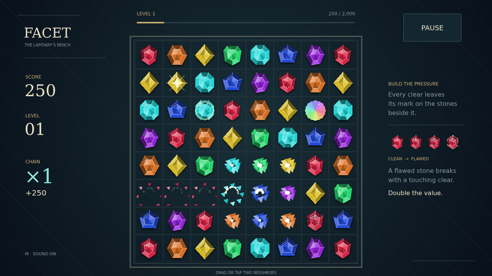

# Facet

A quiet bench. Seven kinds of stone. One small swap that could bring the whole arrangement down. Drag a gem onto its neighbor, or tap the pair, and release to make a line of three or more shatter.

The stones left standing remember. Every clear puts strain into its neighbors, opening hairline cracks that spread until a gem is flawed. Touch that flaw with another clear and it breaks too, for double the points. Build pressure in a crowded corner, then find the move that spends it.

Longer lines leave rarer cuts. Four stones make a brilliant that breaks the surrounding ring. Crossing lines make a star that sweeps a row and column. Five or more leave a prism: trade it against a stone to clear that entire kind.

New stones fall into the gaps, and every match they make climbs the chain multiplier. Fill the level meter to open a fresh bench with a higher target. Keep finding the fractures until no productive swap remains.

